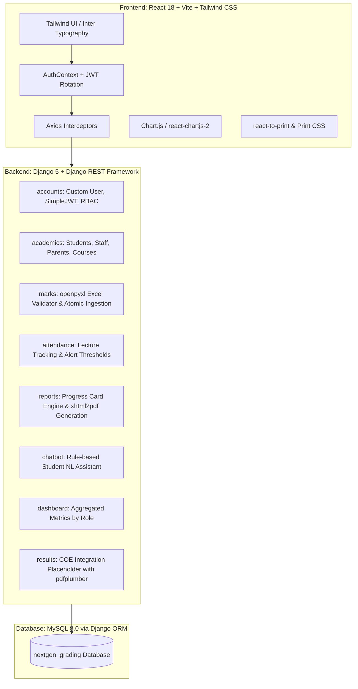

# Next Gen Grading – Academic Department Assistance System

A full-stack, production-grade web application built for college academic departments. The system automates the preparation of digital student progress reports for parent–teacher meetings (PTM), replacing manual register collection and spreadsheet consolidation.

---

## 1. System Architecture & Tech Stack



### Backend
- **Python 3.11+ / Django 5 / Django REST Framework (DRF)**: Strict API-first architecture
- **MySQL 8.0 via Django ORM**: No raw SQL; strict relational integrity, composite keys, and indexing
- **PyMySQL & mysqlclient**: Auto-patched for Windows compatibility
- **djangorestframework-simplejwt**: Access & Refresh token rotation
- **openpyxl & pandas**: High-speed Excel template generation and preview validation
- **xhtml2pdf**: Pure-Python server-side A4 PDF document rendering
- **pdfplumber**: Integrated and reserved for external Controller of Examinations (COE) results extraction

### Frontend
- **React 18 & Vite**: Lightning-fast dev server and optimized production bundles
- **Tailwind CSS**: Academic blue/indigo palette with responsive layout and `@media print` support
- **React Router v6**: Role-based `ProtectedRoute` guards for Admin, Staff, Student, and Parent
- **Axios**: Bearer token injection and seamless 401 token refresh retry queue
- **Chart.js & react-chartjs-2**: Interactive marks distribution bars and attendance doughnut charts
- **react-hot-toast & lucide-react**: Modern feedback toasts and iconography

---

## 2. Roles & Access Control (RBAC)

| Role | Permissions & Portals |
|---|---|
| **Admin** | Full system control: Manage Students, Faculty Staff, Parents, Courses, Parent-Ward Links; Audit Marks Upload Logs; View all Class Progress Reports. |
| **Staff** | Upload Marks via 3-step Excel Wizard; Enter/Update Attendance with live shortage warnings; View Class Reports; Preview & Download Individual/Bulk Progress Cards. |
| **Student** | View-only personal Digital Progress Card, Attendance Breakdown, Visual Analytics; Interactive AI Assistant Chatbot. |
| **Parent** | View-only progress card and attendance for their linked child; PTM shortage alerts. |

---

## 3. Demo Login Credentials

You can use the **1-Click Demo Login** buttons on the login screen (`/login`) or enter these credentials:

| Role | Username | Password | Context |
|---|---|---|---|
| **Admin** | `admin` | `admin123` | System Administrator |
| **Staff** | `staff_sharma` | `staff123` | Prof. Ramesh Sharma (CS501 & CS503) |
| **Staff** | `staff_verma` | `staff123` | Prof. Priya Verma (CS502 & CS504) |
| **Student** | `student1` | `student123` | Aarav Patel (`21CS001`) – High Performer (95% Att.) |
| **Student** | `student4` | `student123` | Ananya Sen (`21CS004`) – Critical Shortage (67.5% Att.) |
| **Parent** | `parent_patel` | `parent123` | Suresh Patel (Linked to Aarav Patel) |
| **Parent** | `parent_sen` | `parent123` | Meenakshi Sen (Linked to Ananya Sen) |

---

## 4. Getting Started & Setup

### Prerequisites
- Python 3.11+
- Node.js 18+ & npm
- MySQL Server 8.0 running locally on port `3306`

### Step 1: Clone or Navigate to Directory
```bash
cd "g:/new gen grading"
```

### Step 2: MySQL Database Setup
Ensure MySQL service is running. Connect to MySQL and create the database:
```sql
CREATE DATABASE IF NOT EXISTS nextgen_grading CHARACTER SET utf8mb4 COLLATE utf8mb4_unicode_ci;
```

### Step 3: Backend Setup
```bash
cd backend

# 1. Install dependencies
pip install -r requirements.txt

# 2. Configure .env (Pre-configured with local credentials)
# Verify DB_PASSWORD=12345 in backend/.env matches your local MySQL root password

# 3. Apply database migrations
python manage.py migrate

# 4. Populate realistic demo department dataset
python manage.py seed_data

# 5. Start Django REST API server
python manage.py runserver 127.0.0.1:8000
```
*Backend API runs at: `http://127.0.0.1:8000/`*  
*Django Admin Portal: `http://127.0.0.1:8000/admin/`*

### Step 4: Frontend Setup
In a new terminal window:
```bash
cd frontend

# 1. Install frontend dependencies
npm install

# 2. Start Vite development server
npm run dev
```
*Frontend Application opens at: `http://localhost:5173/`*

---

## 5. Core Feature Workflows

### A. 3-Step Excel Marks Upload Wizard
1. **Step 1 - Select & Download**: Staff picks their course (e.g. `CS501`) and assessment cycle (`IA1`/`IA2`/`IA3`). Clicking **"Download Sample Sheet"** generates a pre-formatted Excel file populated with registered students.
2. **Step 2 - Drag & Drop Preview**: Staff drops the filled `.xlsx` sheet. The system validates:
   - Presence of required columns (`Register Number`, `Marks`)
   - Unknown students or register numbers outside the semester
   - Duplicate register numbers in the sheet
   - Negative marks or marks exceeding `max_internal_marks`
   - Invalid rows are highlighted in red with exact error badges. The **Confirm** button is disabled until all errors are resolved.
3. **Step 3 - Atomic Confirmation**: Saves records inside a `transaction.atomic()` block using `update_or_create` and logs an entry in `UploadLog`.

### B. Dynamic Attendance Management
- Staff enters classes held and attended.
- Immediate visual indicators:
  - **Green (Normal)**: `> 85%`
  - **Amber (Warning)**: `75% - 85%`
  - **Red (Critical Shortage)**: `< 75%` (Mandatory PTM alert)

### C. Digital Progress Card & Server-Side PDF
- Includes institutional header, student metadata, subject-wise IA1/IA2/IA3 marks, average, attendance, automated qualitative remarks, and signature blocks.
- **Print**: Styled with `@media print` for browser printing without UI artifacts.
- **Download PDF**: Generates branded A4 PDF via `xhtml2pdf`.
- **Bulk PDF**: Generates a consolidated class document for PTM meetings.

### D. Student AI Chatbot Assistant
- Floating bottom-right widget for students.
- Natural language intent matching with instant responses:
  - *"What is my attendance in CS501?"*
  - *"What are my marks in Database Management Systems?"*
  - *"Which subject is my weakest?"*
  - *"Give me study tips for the upcoming assessments"*

### E. Future-Ready Architecture (COE Semester Results)
- Modular app `results` and model `SemesterResult` pre-built.
- Prepared for external University PDF extraction using `pdfplumber` to synthesize internal continuous assessment marks with final university grades.

---

## 6. Running Automated Tests

To execute the backend test suite:
```bash
cd backend
python manage.py test accounts.test_accounts marks.test_marks attendance.test_attendance reports.test_reports
```

To verify the frontend build:
```bash
cd frontend
npm run build
```
